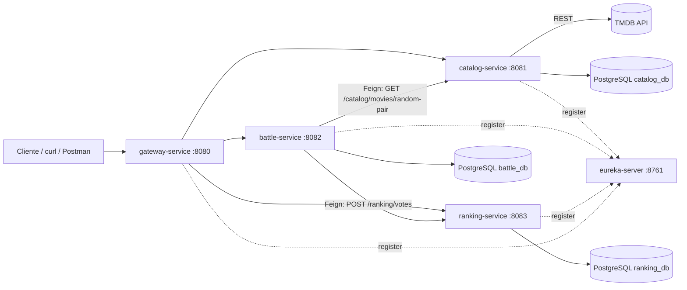
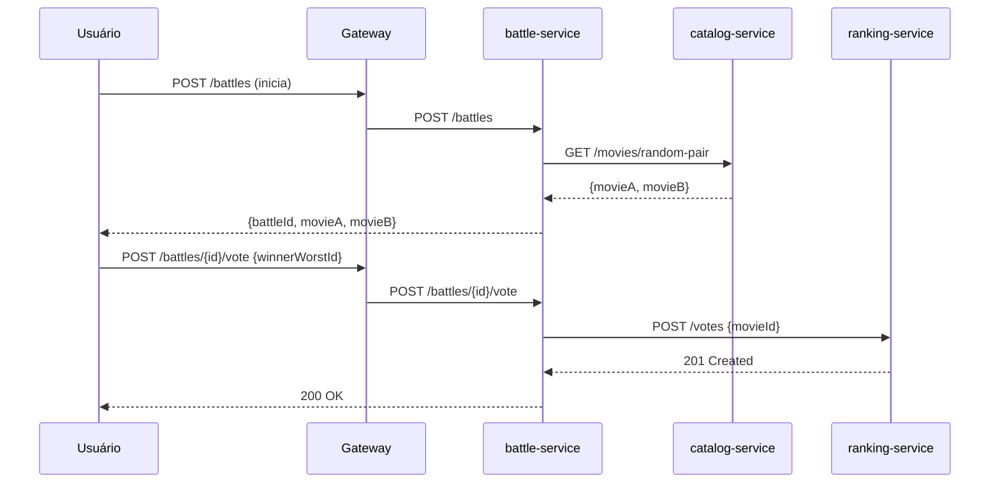

# Movie Battle — Microsserviços (Trabalho Final)

Aplicação **sem frontend** baseada em microsserviços (monorepo) onde usuários montam um catálogo de filmes
(buscando no TMDB) e "batalham" filmes: o sistema sorteia 2 filmes do catálogo, o usuário escolhe o pior,
e o filme escolhido ganha um ponto de "ruindade". Existe um ranking dos 10 piores filmes.

## Stack

- **Java 21**, **Spring Boot 3.3+**, **Spring Cloud 2023.0.x**
- **Spring Cloud Netflix Eureka** (discovery-service)
- **Spring Cloud Gateway** (gateway-service) — única porta exposta ao cliente (8080)
- **Spring Data JPA + PostgreSQL** (um banco por serviço: `catalog_db`, `battle_db`, `ranking_db`)
- **OpenFeign** para comunicação síncrona entre serviços
- **Maven multi-módulo** (monorepo)
- Sem Docker (PostgreSQL instalado localmente); cada serviço lê config de `application.properties`
- Sem autenticação (acesso anônimo)

## Serviços e portas

| Serviço            | Módulo Maven        | Porta | Banco          | Responsabilidade                                              |
|--------------------|---------------------|-------|----------------|---------------------------------------------------------------|
| discovery-service  | discovery-service   | 8761  | —              | Eureka Server                                                 |
| gateway-service    | gateway-service     | 8080  | —              | Roteamento único para o cliente                                |
| catalog-service    | catalog-service     | 8081  | catalog_db     | Busca no TMDB, registra filmes, sorteia 2 filmes              |
| battle-service     | battle-service      | 8082  | battle_db      | Orquestra batalha: pega 2 do catálogo, recebe voto, notifica ranking |
| ranking-service    | ranking-service     | 8083  | ranking_db     | Persiste filme + voto, expõe top 10 piores                     |

## Arquitetura (diagrama)



Fluxo de batalha (sequência):



## Estrutura do monorepo (Maven)

```
trabalho-final/
├── pom.xml                          # parent
├── discovery-service/
│   ├── pom.xml
│   └── src/main/java/.../DiscoveryServiceApplication.java
├── gateway-service/
├── catalog-service/
├── battle-service/
└── ranking-service/
```

Parent `pom.xml`: packaging `pom`, Spring Boot parent 3.3.x, Spring Cloud BOM 2023.0.x,
Java 21, módulos listados.

## Modelos de dados

### catalog_db — tabela `movies`

| coluna        | tipo          | obs                                    |
|---------------|---------------|----------------------------------------|
| id            | BIGSERIAL PK  | id interno                             |
| external_id   | BIGINT        | id do TMDB (inteiro, unique) — armazenado como Long |
| title         | VARCHAR(255)  |                                        |
| poster_path   | VARCHAR(512)  | URL/path do poster                     |
| release_year  | INT           | ano de lançamento                      |
| created_at    | TIMESTAMP     | default now                            |

### battle_db — tabela `battles`

| coluna        | tipo          | obs                                    |
|---------------|---------------|----------------------------------------|
| id            | UUID PK       | id da batalha                          |
| movie_a_id    | BIGINT        | id interno do catálogo (movie A)       |
| movie_b_id    | BIGINT        | id interno do catálogo (movie B)       |
| chosen_movie_id | BIGINT NULL | filme votado como pior                 |
| created_at    | TIMESTAMP     |                                        |
| voted_at      | TIMESTAMP NULL|                                        |

> Observação: battle-service guarda apenas o par sorteado e o voto; não duplica dados do filme.

### ranking_db — tabelas `ranked_movies` e `votes`

`ranked_movies`:

| coluna        | tipo          | obs                                    |
|---------------|---------------|----------------------------------------|
| id            | BIGSERIAL PK  |                                        |
| movie_id      | BIGINT        | id interno do catálogo (referência lógica) |
| external_id   | BIGINT        | id TMDB (inteiro)                      |
| title         | VARCHAR(255)  |                                        |
| poster_path   | VARCHAR(512)  |                                        |
| release_year  | INT           |                                        |

> Sem coluna de contador: a contagem de ruindade é calculada por agregação sobre `votes`
> (`COUNT(*)`), e o desempate usa `MAX(voted_at)`.

`votes`:

| coluna        | tipo          | obs                                    |
|---------------|---------------|----------------------------------------|
| id            | BIGSERIAL PK  |                                        |
| movie_id      | BIGINT        | FK lógica para ranked_movies.id        |
| voted_at      | TIMESTAMP     | default now                            |

> Ao receber um voto: upsert em `ranked_movies` (incrementa `badness_count`, atualiza `last_vote_at`),
> e insere linha em `votes`.

## Endpoints (expostos via gateway em `http://localhost:8080`)

### catalog-service (`/catalog`)

- `GET /catalog/movies/search?query={nome}&page={n}` → lista de filmes do TMDB (default page=1)
  - Response: `{ page, totalPages, totalResults, results: [{ externalId, title, posterPath, releaseYear }] }`
- Swagger/OpenAPI: `http://localhost:8080/{serviço}/swagger-ui.html` (por serviço)
- `POST /catalog/movies` body `{ "externalId": "123" }` → registra filme (idempotente por externalId)
  - Response: `{ id, externalId, title, posterPath, releaseYear }`
- `GET /catalog/movies/random-pair` → dois filmes distintos aleatórios do banco
  - Response: `{ "movieA": {...}, "movieB": {...} }`
  - 400 se houver menos de 2 filmes cadastrados
- `GET /catalog/movies` → lista todos os cadastrados (opcional, útil para debug)

### battle-service (`/battles`)

- `POST /battles` → inicia batalha: busca par no catálogo, persiste, retorna `{ battleId, movieA, movieB }`
- `POST /battles/{battleId}/vote` body `{ "chosenMovieId": <id interno catálogo> }`
  - valida que o id é um dos dois do par; notifica ranking-service; retorna 200

### ranking-service (`/ranking`)

- `POST /ranking/votes` body `{ "movieId": <id interno catálogo>, "externalId", "title", "posterPath", "releaseYear" }`
  - upsert + incremento + insert vote
- `GET /ranking/top10` → top 10 por `badness_count` desc, desempate `last_vote_at` desc

### discovery / gateway

- Eureka dashboard: `http://localhost:8761`
- Gateway base: `http://localhost:8080`

## Comunicação entre serviços (Feign)

- `battle-service` → `catalog-service`: `CatalogClient.getRandomPair()`
- `battle-service` → `ranking-service`: `RankingClient.registerVote(VoteRequest)`
- Usar `@FeignClient(name = "catalog-service")` / `name = "ranking-service"` (resolvidos via Eureka).

## TMDB

- Base URL: `https://api.themoviedb.org/3`
- Acesso via **Feign Client** (`TmdbClient`) com `api_key` como query param
- Endpoint de busca: `GET /search/movie?api_key={KEY}&query={nome}&language=pt-BR`
- Toda comunicação HTTP (TMDB e inter-serviços) padronizada com OpenFeign
- Chave via variável de ambiente `TMDB_API_KEY` (não commitar).
- Mapear para DTO: `id` → externalId, `title`, `poster_path` → `https://image.tmdb.org/t/p/w500{poster_path}`, `release_date` → year.

## Configuração (exemplo application.properties)

catalog-service (`src/main/resources/application.properties`):
```properties
server.port=8081
spring.application.name=catalog-service
spring.datasource.url=jdbc:postgresql://localhost:5432/catalog_db
spring.datasource.username=postgres
spring.datasource.password=postgres
spring.jpa.hibernate.ddl-auto=update
eureka.client.service-url.defaultZone=http://localhost:8761/eureka/
tmdb.api-key=${TMDB_API_KEY}
tmdb.base-url=https://api.themoviedb.org/3
```

Análogo para os demais (battle_db, ranking_db), portas 8082/8083. Todos os serviços usam `application.properties` como padrão.

## Regras de negócio importantes

1. Sorteio de dois filmes distintos: se o primeiro sorteio repetir, buscar novamente até obter dois distintos (ou até N tentativas); se houver <2 filmes, retornar 400.
2. Registro idempotente por `externalId`: se já existe, retorna o existente (200), não cria duplicata.
3. Voto válido apenas se `chosenMovieId` for um dos dois filmes da batalha; caso contrário 400.
4. Batalha não pode ser votada duas vezes (idempotência: se já votada, 409).
5. Ranking top 10: `ORDER BY badness_count DESC, last_vote_at DESC LIMIT 10`.
6. Desempate por último voto mais recente.

## Perguntas em aberto (para o grupo decidir)

- Precisam de endpoint para remover/editar filme do catálogo?
- O battle-service deve persistir batalhas ou apenas orquestrar em memória? (proposto: persistir para auditoria)
- Formato de erro padrão (ProblemDetail RFC 7807) ou JSON simples `{ "message": ... }`?
- Versionamento da API (`/v1/...`)?
- Testes: apenas unitários ou também integração com Testcontainers?
- Precisam de Swagger/OpenAPI em cada serviço?
- O ranking deve exibir também o total de votos global?

## Como rodar (sem Docker)

1. Instalar PostgreSQL local e criar databases: `catalog_db`, `battle_db`, `ranking_db`.
2. Exportar `TMDB_API_KEY`.
3. Subir na ordem: discovery-service → (catalog, ranking, battle) → gateway-service.
4. Testar via gateway `http://localhost:8080`.

## Exemplo de uso (curl)

```bash
# buscar filmes
curl "http://localhost:8080/catalog/movies/search?query=matrix"

# registrar filme (externalId do TMDB)
curl -X POST http://localhost:8080/catalog/movies -H 'Content-Type: application/json' -d '{"externalId":"603"}'

# iniciar batalha
curl -X POST http://localhost:8080/battles

# votar (chosenMovieId = id interno retornado)
curl -X POST http://localhost:8080/battles/{battleId}/vote -H 'Content-Type: application/json' -d '{"chosenMovieId":1}'

# ranking
curl http://localhost:8080/ranking/top10
```
